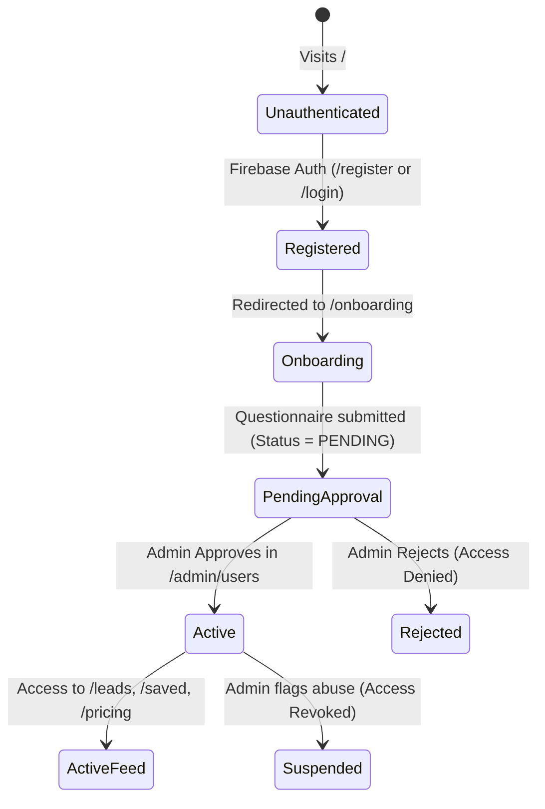
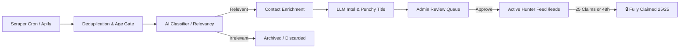

# APPFLOW.md — Lead Hunter System Journeys & State Transitions

> **Purpose:** Canonical documentation of user journeys, screen flows, state machines, and cross-service data boundaries for developers and AI agents working on Lead Hunter.

---

## 1. User Lifecycles & Account States

### Account State Enforcement (`ClientLayout.tsx`)
1. **`PENDING`:** Automatically redirected to `/pending-approval`. Cannot view the lead feed or unlock contact cards.
2. **`ACTIVE`:** Unrestricted access to `/leads`, `/saved`, `/pricing`, and credit wallet.
3. **`SUSPENDED` / `REJECTED`:** Access blocked with status notification banner.

---

## 2. Lead Ingestion & Value Lifecycle

### Lead States (`lead_posts.status` & `lead_posts.review_status`)
- **`pending` $\to$ `relevant`:** Classified by local AI microservice (`:8000/classify`) or hard contractor/agency regex filters.
- **`awaiting_review` $\to$ `approved`:** Admin approves the lead in `/admin/review` or `/admin/leads`.
- **Visibility Condition:** Only leads where `review_status = 'approved'` AND `is_deleted = false` appear on `/leads`.

---

## 3. Lead Claiming & 48-Hour Lock Flow

1. **Active Lead (< 25 claims & < 48 hours old):**
   - Hunter sees: Green **"Unlock & Save (-10 Credits)"** button.
   - Counter shows: `X/25 claimed · Y left`.
2. **Claim Action:**
   - Hunter clicks **Unlock & Save**.
   - Credits deducted in strict priority: `rolloverBalance` $\to$ `subscriptionBalance` $\to$ `bonusBalance`.
   - `claims` row created, `user_lead_states` marked `isRevealed = true`.
   - Prospect phone, email, and company name unmask permanently for that user.
3. **Locked Lead (Reaches 25 claims OR $\ge$ 48 hours old):**
   - Button permanently transforms into amber lock badge: **`🔒 Fully Claimed (25/25)`**.
   - Contact information remains strictly confidential to anyone who hasn't already unlocked it.
   - Pushed down in feed sorting order.

---

## 4. Navigation & Route Hierarchy

### Public & Onboarding Routes
- `/` — Landing Page (or `ComingSoon.tsx`; preview via `/?preview=1`).
- `/pricing` — Plan comparison (Free Starter vs Freelancer Pro ₹999/mo) and credit top-up packs.
- `/register` & `/login` — Firebase Authentication (Email/Password & Phone OTP).
- `/onboarding` — 4-step hunter intake questionnaire (Niches, experience, portfolio).
- `/pending-approval` — Gated holding page for accounts awaiting verification.

### Hunter Workspace Routes
- `/leads` — Core demand-generation feed, niche filters, search, and sliding `LeadDrawer`.
- `/saved` — Unlocked prospects, direct outreach composer, and CSV exports.
- `/settings` — Account profile, credit wallet breakdown, and active subscription status.

### Admin Suite Routes (`/admin/*` — Scoped by RBAC)
- `/admin/review` — Rapid swipe queue to approve/reject freshly scraped leads.
- `/admin/leads` — Master opportunity table with manual contact editing and instant drops.
- `/admin/users` — Hunter onboarding approval, plan overrides, and credit grants.
- `/admin/tokens` — Multi-engine Apify/Scrapedog/Crawlbase quota monitoring & live balance tracking.
- `/admin/broadcast` — WhatsApp & email automated community alerts.

---

## 5. Technical Data Boundaries

| Service | Host / Port | Responsibility | Data Store |
| :--- | :--- | :--- | :--- |
| **Frontend** | `localhost:3000` (Next.js 14) | UI, Lead Drawer, Checkout, Client Layout Gate | PostgreSQL (Supabase pooler) |
| **Backend API** | `localhost:5001` (Express 5) | Scraping workers, BullMQ queues, Apify rotation | PostgreSQL / SQLite |
| **AI Classifier** | `localhost:8000` (FastAPI) | Text classification (`/classify`), OCR (`/ocr`) | Local ML model |
| **Redis** | `localhost:6379` | Distributed queues, BullMQ, rate-limit stores | In-memory cache |
